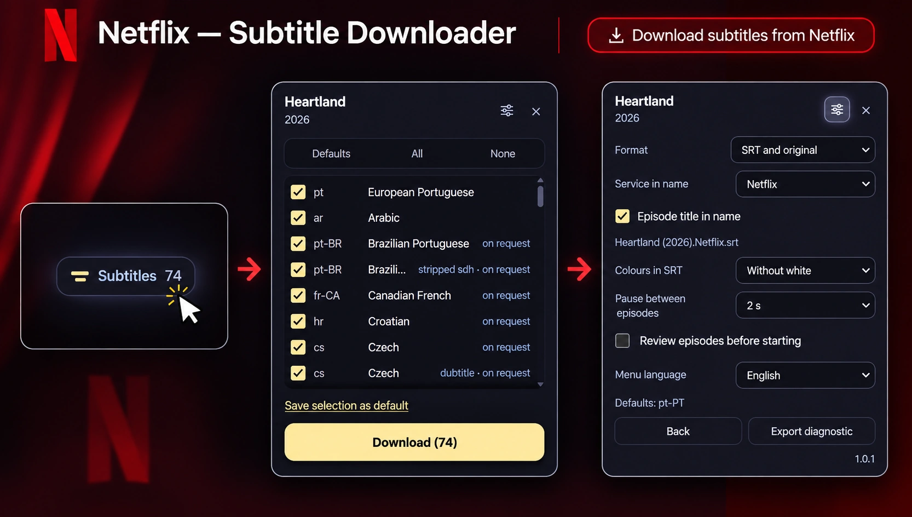
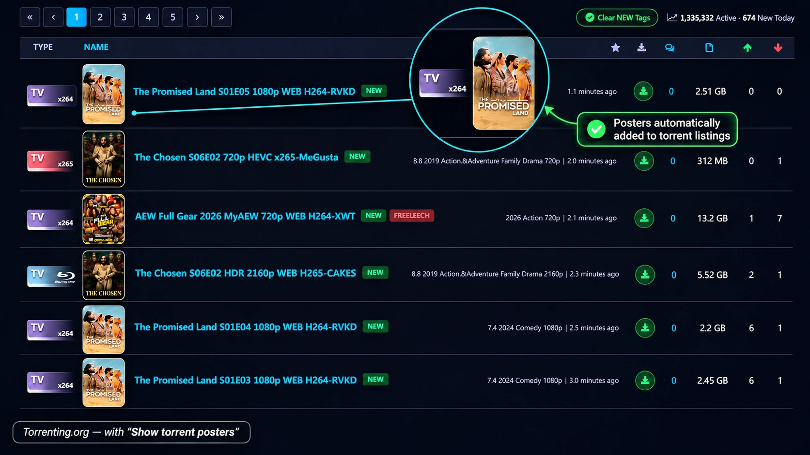
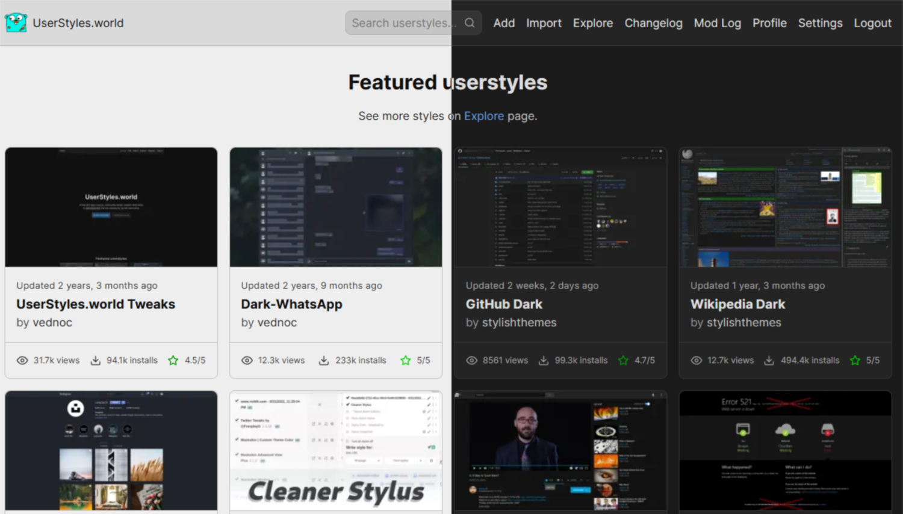
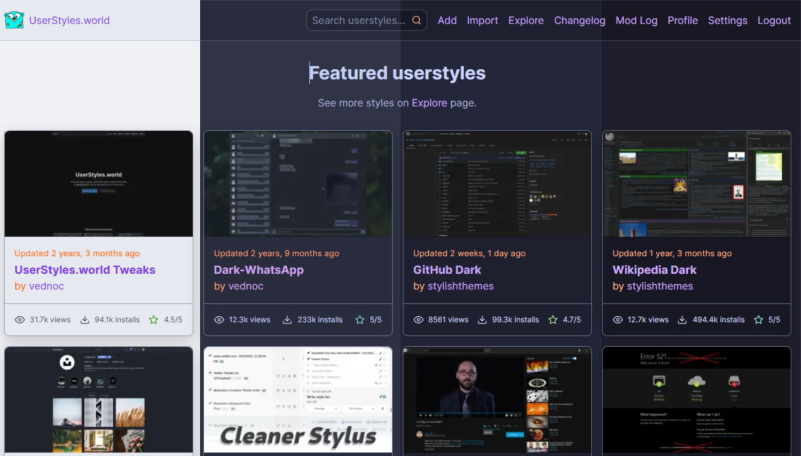
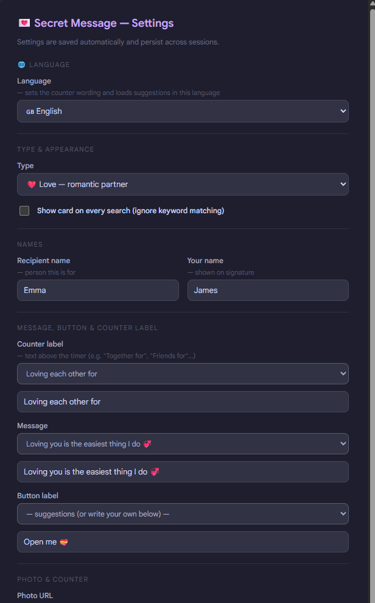
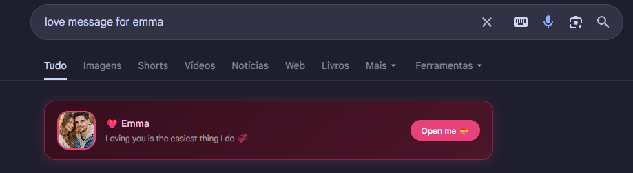
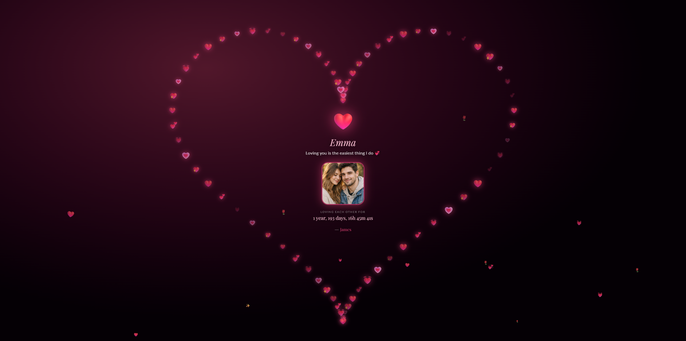
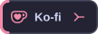

<a id="top"></a>

<p align="center">
  <a href="https://github.com/BlackSpirits/UserScripts-UserStyles" rel="noopener noreferrer">
    <picture>
      <source srcset="./assets/readme-hero.svg" type="image/svg+xml" />
      
    </picture>
  </a>
</p>

<h3 align="center">Small browser enhancements. Thoughtful by design.</h3>

<p align="center">
  Practical userscripts and userstyles for cleaner interfaces, accessible workflows,
  media tools and everyday browsing. Built and maintained by
  <a href="https://github.com/BlackSpirits"><strong>BlackSpirits</strong></a>.
</p>

<p align="center">
  <a href="https://github.com/BlackSpirits/UserScripts-UserStyles/stargazers" aria-label="See repository stars"></a>
  <a href="https://github.com/BlackSpirits/UserScripts-UserStyles/issues" aria-label="See open GitHub issues"></a>
  <a href="./LICENSE"></a>
</p>

<div align="center"></div>

<p align="center">
  <a href="#catalog">Browse projects</a> &nbsp;·&nbsp;
  <a href="#install">Installation</a> &nbsp;·&nbsp;
  <a href="#screenshots">Screenshots</a> &nbsp;·&nbsp;
  <a href="#contributing">Contributing</a> &nbsp;·&nbsp;
  <a href="#support">Support</a>
</p>

<a id="-available-scripts--styles"></a>
<a id="catalog"></a>
## <sub></sub> Explore the collection

Select **UserScript** or **UserStyle** under **Install**. Click a project name to view its source on GitHub. Published UserScripts open on Greasy Fork; you'll need a compatible browser extension.

| Project | What it does | Install |
|:--------|:-------------|:--------|
| **[Netflix — Subtitle Downloader](https://github.com/BlackSpirits/UserScripts-UserStyles/blob/main/userscripts/netflix/netflix-subtitle-downloader.user.js)** | SRT/WebVTT/TTML subtitles, language presets and resumable batches. | [](https://greasyfork.org/pt/scripts/605588-netflix-subtitle-downloader) |
| **[IMDb — Catppuccin Mocha Theme](https://github.com/BlackSpirits/UserScripts-UserStyles/blob/main/userstyles/imdb/imdb-catppuccin-mocha.user.css)** | A Catppuccin Mocha dark theme for IMDb. | [](https://raw.githubusercontent.com/BlackSpirits/UserScripts-UserStyles/main/userstyles/imdb/imdb-catppuccin-mocha.user.css) |
| **[UserStyles.world — Catppuccin Theme](https://github.com/BlackSpirits/UserScripts-UserStyles/blob/main/userstyles/userstyles-world/userstyles-world-catppuccin.user.css)** | Catppuccin palettes with refined layouts and contrast. | [](https://raw.githubusercontent.com/BlackSpirits/UserScripts-UserStyles/main/userstyles/userstyles-world/userstyles-world-catppuccin.user.css) |
| **[IMDb — Ad & IMDbPro Cleaner](https://github.com/BlackSpirits/UserScripts-UserStyles/blob/main/userscripts/imdb/imdb-adpro-cleaner.user.js)** | Hides ads, sponsored labels and IMDbPro prompts. | [](https://greasyfork.org/pt/scripts/545323) |
| **[Torrenting — Show torrent posters](https://github.com/BlackSpirits/UserScripts-UserStyles/blob/main/userscripts/torrenting/torrenting-show-posters.user.js)** | Adds movie and TV posters to listings on Torrenting.org and Torrenting.com. | [](https://greasyfork.org/pt/scripts/540357-torrenting-show-torrent-posters) |
| **[Google — Secret Message](https://github.com/BlackSpirits/UserScripts-UserStyles/blob/main/userscripts/google/google-secret-message.user.js)** | Personalised search cards and animated surprise pages. | [](https://raw.githubusercontent.com/BlackSpirits/UserScripts-UserStyles/main/userscripts/google/google-secret-message.user.js) |

<div align="center"></div>

<a id="-netflix--subtitle-downloader"></a>
<a id="netflix"></a>
## <sub></sub> Netflix — Subtitle Downloader


Downloads the subtitles of the Netflix film or episode you are watching. A small button at the top of the player opens the menu: pick the languages and click **Download**.

**Features**
- Saves SRT, the original WebVTT/TTML, or both
- Lists the available text subtitle tracks, including those whose download addresses Netflix only provides on request
- Default languages ticked automatically on every title
- Season and whole-series batches in a single ZIP, with pause, resume and automatic retry when Netflix stalls
- SRT keeps italics, bold, underline, colours and top positioning (`{\an8}`); white, the player default, is left out unless you choose otherwise
- File names with optional episode title and service tag (`Netflix` or `NF`)
- Warns when Netflix changes something the script depends on, with an exportable diagnostic (no cookies, addresses or subtitle text)
- Menu in 13 languages, following the Netflix interface language

**Known limitations**
- Image-only subtitle tracks and forced tracks without a download address cannot be saved
- Tracks fetched on request briefly change the subtitle shown in the player; your own choice is restored afterwards
- Downloading every language for a whole series in "SRT and original" can exceed the 384 MB batch limit; the batch then pauses and offers the ZIP done so far

Found a problem? Use **Export diagnostic** in the settings and attach the file to an [issue](https://github.com/BlackSpirits/UserScripts-UserStyles/issues).


<a id="-imdb--catppuccin-mocha-theme"></a>
<a id="imdb-catppuccin"></a>
## <sub></sub> IMDb — Catppuccin Mocha Theme

Full dark theme for IMDb built on the **Catppuccin Mocha** palette.

**Features**
- Catppuccin Mocha palette applied across all IMDb pages
- Transparent **hero rating bar** with unified hover and border-radius
- Styled header flyouts (User / Language) and **autosuggest dropdown**
- **Awards** highlights and consistent subnav spacing
- Unified link styling for "Cast & crew", "Company credits", "All topics" — peach with lavender hover
- **Full Credits**: single container with soft dividers; actor names in mauve, character names in peach
- **Filmography accordions**: transparent headers with a single bottom divider
- Icon and ribbon contrast fixed for dark backgrounds

**Support**  
Bug reports and feature requests → [GitHub Issues](https://github.com/BlackSpirits/UserScripts-UserStyles/issues)

<details>
  <summary><b>Changelog (latest: v2.8)</b></summary>
  <br>
  <ul>
    <li><b>v2.8</b> — Minor palette refinements and selector updates.</li>
    <li><b>v2.7</b> — Completed dark-mode coverage for Contribution & Help pages; improved metadata contrast.</li>
    <li><b>v2.6</b> — Refined Full Credits layout; improved Filmography accordions.</li>
    <li><b>v2.5</b> — Unified menu backgrounds; refined hover and focus states.</li>
    <li><b>v2.0</b> — Major refresh with Catppuccin Mocha palette.</li>
  </ul>
  <p><sub>Full detailed changelog: <a href="https://userstyles.world/style/23644/imdb-catppuccin-mocha-theme">UserStyles.world</a></sub></p>
</details>


<a id="-userstylesworld--catppuccin-theme"></a>
<a id="userstyles-world"></a>
## <sub></sub> UserStyles.world — Catppuccin Theme

**Features**
- Supports all Catppuccin variants: Latte, Frappé, Macchiato, Mocha
- Unified cards, headers, and navigation styling
- Improved contrast and spacing for listings and metadata
- Consistent hover and focus states throughout


<a id="-imdb--ad--imdbpro-cleaner"></a>
<a id="imdb-cleaner"></a>
## <sub></sub> IMDb — Ad & IMDbPro Cleaner

Hides ads, sponsored labels and IMDbPro upsells on IMDb without removing any page content.

**Features**
- Hides IMDb ad slots and sponsored labels
- Hides IMDbPro links, badges and upsell panels
- CSS only: no page content is removed, no text matching, no changes to IMDb's own scripts
- Works on content loaded later (client-side navigation, expanded sections) with no extra processing


<a id="-torrentingcom--auto-posters"></a>
<a id="torrenting-posters"></a>
## <sub></sub> Torrenting — Show torrent posters

Displays movie and series posters in torrent listings on Torrenting.org and Torrenting.com.

**Features**
- Supports all page types: featured, browse, requests, torrent details
- Poster cache keyed by torrent ID — no redundant fetches on navigation
- Debounced `MutationObserver` for minimal performance overhead
- SVG placeholder for missing posters
- Lazy loading and async decoding for performance
- Same-origin fetch — no external requests


<a id="-google--secret-message"></a>
<a id="google-message"></a>
## <sub></sub> Google — Secret Message


Injects a personalised card above Google search results whenever a trigger keyword is searched, and opens a beautiful full-screen animated surprise page when clicked.  
All settings are managed through the **Tampermonkey / Violentmonkey menu** — no code editing required.

<details>
  <summary><b>Built-in message types</b></summary>

**6 built-in types** — one `type` field changes everything: colour, icon, particles, animated shape, and keywords.

| Type | Colour | Icon | Shape outline | Ideal for |
|------|--------|------|---------------|-----------|
| `"love"` | 🌹 Rose pink | ❤️ | Heart | Romantic partner |
| `"friendship"` | 💛 Amber | 💛 | Star | Best friend |
| `"family"` | 💚 Teal | 💚 | Hexagon | Sibling, child, family |
| `"parents"` | 💜 Purple | 💜 | Flower | Mum, dad, grandparent |
| `"pets"` | 🧡 Orange | 🐾 | Paw | Dog, cat, any pet |
| `"custom"` | ✏️ Your choice | ✏️ | Infinity | Full manual control |

</details>

**Features**
- Compact card injected above results — icon/photo, message, and surprise button
- Full-screen glassmorphism surprise page with floating particles, animated shape outline, and live counter
- **Settings panel** via the userscript manager menu — configure everything without editing code
- `alwaysShow` toggle — show card on every Google search regardless of keywords
- Any field left blank (`""`) automatically uses the type's built-in default
- Auto browser language detection (`lang: "auto"`) — **29 languages**, **45+ regional variants**
- Adapts to Google's **dark mode** automatically
- Works on all **191 Google country domains**
- No external JavaScript dependencies
- Resilient injection via multiple CSS selectors + `MutationObserver` for Google's SPA navigation

<details>
  <summary><b>Advanced configuration example</b></summary>

**Quick-start CONFIG** — only 3 fields are required; everything else is optional:

```js
const CONFIG = {
    type:              "love",      // "love" | "friendship" | "family" | "parents" | "pets" | "custom"
    recipientName:     "Emma",      // name shown on the card and surprise page
    senderName:        "James",     // your name, shown on the signature

    // Optional — leave "" to use the type's built-in defaults:
    message:           "",
    buttonLabel:       "",
    counterLabel:      "",          // override the "Together for" label
    photoUrl:          "",          // direct image URL
    photoStyleCard:    "circle",    // "circle" | "square" | "rounded" | "portrait"
    photoStyleSurprise:"circle",
    since:             "",          // "2023-06-21T19:00:00" — shows a live counter
    lang:              "auto",      // "auto" reads the browser language
    accentColor:       "",          // override the type's colour
    icon:              "",          // override the type's emoji
    alwaysShow:        false,       // true = show on every Google search
};
```

</details>

<details>
  <summary><b>Type examples across languages</b></summary>
  <br>

  **💖 Love**
  | 🌍 | `recipientName` | `senderName` | `message` | `lang` |
  |----|-----------------|--------------|-----------|--------|
  | 🇬🇧 | Emma | James | Every moment with you feels like home 🌟 | `"en"` |
  | 🇵🇹 | Sofia | Tiago | O teu sorriso ilumina o meu mundo 🌟 | `"pt-PT"` |
  | 🇫🇷 | Camille | Léo | Chaque instant à tes côtés est un cadeau 🌟 | `"fr"` |
  | 🇪🇸 | Lucía | Marcos | Contigo el mundo tiene más sentido 🌟 | `"es"` |
  | 🇩🇪 | Mia | Leon | Mit dir ist jeder Tag ein Geschenk 🌟 | `"de"` |

  **💛 Friendship**
  | 🌍 | `recipientName` | `message` |
  |----|-----------------|-----------| 
  | 🇬🇧 | Alex | Lucky to have you in my life 🌟 |
  | 🇵🇹 | Margarida | Tenho muita sorte por te ter na minha vida 🌟 |
  | 🇫🇷 | Théo | Chanceux de t'avoir dans ma vie 🌟 |

  **💜 Parents**
  | 🌍 | `recipientName` | `message` |
  |----|-----------------|-----------| 
  | 🇬🇧 | Mum | Thank you for everything — I love you 💜 |
  | 🇵🇹 | Mãe | Obrigado por tudo — amo-te 💜 |
  | 🇪🇸 | Mamá | Gracias por todo — te quiero 💜 |

  **🐾 Pets**
  | 🌍 | `recipientName` | `message` |
  |----|-----------------|-----------| 
  | 🇬🇧 | Buddy | You make every day brighter, little one 🐾 |
  | 🇵🇹 | Bolinha | Tornas cada dia mais feliz 🐾 |

</details>

<details>
  <summary><b>Changelog (latest: v1.2.0)</b></summary>
  <br>
  <ul>
    <li><b>v1.2.0</b> — Per-type animated shape outlines (heart, star, hexagon, flower, paw, infinity). Settings panel via userscript menu. <code>alwaysShow</code> toggle. Photo shape selector. 29 languages.</li>
    <li><b>v1.1.0</b> — 6 built-in types (love, friendship, family, parents, pets, custom). Per-type accent colour, icon, particles, and keywords. 191 Google domains. Auto dark/light mode.</li>
    <li><b>v1.0.0</b> — Initial release. Universal rewrite. Replaces google-love-message (removed from repo).</li>
  </ul>
</details>


<a id="-installation"></a>
<a id="install"></a>
## <sub></sub> Installation

### UserScripts (.user.js)
1. Install a manager: [Tampermonkey](https://www.tampermonkey.net/) or [Violentmonkey](https://violentmonkey.github.io/).
2. In the **Install** column, select **UserScript** for the project and confirm in your script manager. For published scripts, this takes you to Greasy Fork; **Source** provides the repository-hosted file.

### UserStyles (.user.css)
1. Install [Stylus](https://add0n.com/stylus.html).
2. In the **Install** column, select **UserStyle** for the project and enable it in Stylus.


<a id="-browser-support"></a>
<a id="browser-support"></a>
## <sub></sub> Browser support

| Browser | UserScripts | UserStyles |
|---------|-------------|------------|
| Chrome  | ✔️ Tampermonkey / Violentmonkey | ✔️ Stylus |
| Firefox | ✔️ Works | ✔️ Works |
| Edge    | ✔️ Works | ✔️ Works |
| Safari  | 🧪 Not tested | 🧪 Not tested |

<sub>Legend: ✔️ works · ⚠️ partial · 🧪 not tested · ✖️ no support<br>
Independent community project, not affiliated with Netflix, IMDb, Amazon, Torrenting.org, Torrenting.com or other referenced services. All trademarks belong to their respective owners.</sub>


<a id="️-screenshots"></a>
<a id="screenshots"></a>
## <sub></sub> Screenshots

### Netflix — Subtitle Downloader

<p></p>

### Torrenting — Show torrent posters

<p></p>

### IMDb — Catppuccin Mocha Theme

<details>
  <summary>Before / After</summary>

| Before | After |
|--------|-------|
|  |  |

</details>

### UserStyles.world — Catppuccin Theme

<details>
  <summary>Before / After</summary>

| Default | Catppuccin (Latte · Frappé · Macchiato · Mocha) |
|---------|--------------------------------------------------|
|  |  |

</details>

### Google — Secret Message

<details>
  <summary>Screenshots</summary>

| Settings panel | Card in Google results |
|----------------|------------------------|
|  |  |

| Surprise page |
|---------------|
|  |

</details>


<a id="-releases--changelog"></a>
<a id="changelog"></a>
## <sub></sub> Releases & changelog

See **[Releases](https://github.com/BlackSpirits/UserScripts-UserStyles/releases)** for full change logs or browse [CHANGELOG.md](./CHANGELOG.md) for detailed version history.


<a id="️-contributing--feedback"></a>
<a id="contributing"></a>
## <sub></sub> Contributing & feedback

- Found a bug or have a suggestion? Open an [issue](https://github.com/BlackSpirits/UserScripts-UserStyles/issues).
- Want to improve a script or add a new one? Read the [Contributing Guide](./CONTRIBUTING.md) and send a pull request.


<a id="-support-the-project"></a>
<a id="support"></a>
## <sub></sub> Support the project

If this saves you time or makes your browsing better, a coffee is always appreciated.

<p align="center">
  <a href="https://donate.stripe.com/00w14peB0gBx1tBeOz3Nm00" rel="noopener noreferrer"></a>
  <a href="https://www.paypal.com/paypalme/filipemota" rel="noopener noreferrer"></a>
  <a href="https://ko-fi.com/blackspirits" rel="noopener noreferrer"></a>
  <a href="https://buymeacoffee.com/blackspirits28" rel="noopener noreferrer"></a>
  <a href="mailto:blackspirits@gmail.com" rel="noopener noreferrer"></a>
</p>


<a id="-license"></a>
<a id="license"></a>
## <sub></sub> License

Released under the [MIT License](./LICENSE).  
© 2025–2026 [BlackSpirits](https://github.com/BlackSpirits).

<p align="right"><a href="#top">↑ Back to top</a></p>
